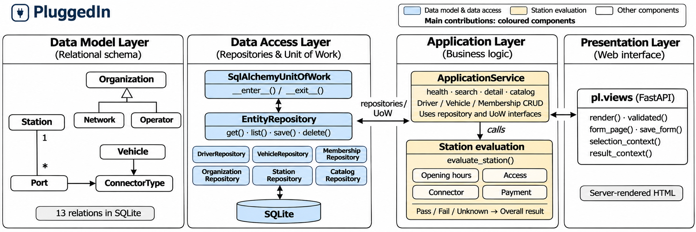

# PluggedIn

**A knowledge-graph-backed web application for vehicle-specific EV charging accessibility in British Columbia.**

PluggedIn helps drivers and fleet operators answer: **Can this driver and vehicle use this charging station at the selected arrival time?** It combines opening hours, site and vehicle access, direct connector compatibility, and payment conditions. Each check is `PASS`, `FAIL`, or `UNKNOWN`; the overall result is `AVAILABLE`, `UNAVAILABLE`, or `NEEDS_REVIEW`. Missing evidence remains unknown rather than being treated as permission to charge.

This README describes the **20-station NLR-OCM Vancouver sample**. The older five-station synthetic demo uses a different dataset.

## Example and supported features


The screenshot illustrates the fixed-date sample below. It is not a live availability report.

- Select a driver and vehicle independently.
- Search using a date and time in **Pacific time (British Columbia)** or UTC; **Search now** uses the current instant.
- Read each station's four checks, reasons, source information, ports, and opening periods.
- Use server-rendered forms, search, and details without JavaScript. Leaflet provides an optional map using OpenStreetMap tiles.

### A repeatable search

With an unchanged sample database:

1. Select **Sample member (synthetic)**, driver ID `1`.
2. Select the **J1772 test car (synthetic)**, vehicle ID `2`.
3. Enter **2026-11-02**, **12:00**, and **Pacific time (British Columbia)**.
4. Search with the initial map bounds and **All statuses**.

Expected result: **20 stations: 1 Available, 19 Needs review, 0 Unavailable**. The Available station is **SWTCH Energy, 5965 Student Union Blvd, Vancouver**, internal station ID `11`. The same instant is `2026-11-02T19:00:00Z`. User edits to profiles, memberships, or station data may change these results.

For a visible operating-hours change, inspect station `5` (**GSPLP TGO 05**): its opening-hours check passes at **12:00** and fails at **23:00** on that Pacific date; at 23:00 its overall result is Unavailable. A daytime opening-hours pass alone does not guarantee an overall Available result. Synthetic sample memberships end on **2026-12-31**, so use the fixed date when reproducing this example.

## Requirements

- Python **3.12 or later**; the checked environment uses **3.12.14**.
- Git to clone the repository; VS Code is optional.
- Runtime packages pinned in [requirements.txt](project/requirements.txt), including FastAPI 0.162.0 and SQLAlchemy 2.0.55.
- OpenLink Virtuoso with a private application graph and a dedicated app credential.
- Internet access for package installation and optional map tiles/fonts.

Windows setup: run [quickstart.ps1](project/quickstart.ps1) using the [Quickstart guide](project/docs/QUICKSTART.md). The script prepares the environment, validates the selected sample, and starts the application.

## Installation and quickstart

Configure Virtuoso and the application credential using the [Quickstart guide](project/docs/QUICKSTART.md).

Before the initial instance-data import, load the RDF/XML ontology (TBox) into the separate `graph/schema/` named graph. Follow the [ontology loading and verification instructions](project/docs/TEAM_RDF_SETUP.en.md#load-the-ontology-tbox).

Keep the ontology graph separate from the private application graph (`graph/app/`), which stores instance data (ABox).

Run the one-time instance-data import from the repository root.

```powershell
powershell -NoProfile -ExecutionPolicy Bypass -File .\project\quickstart.ps1 -Migrate
```

Use `-CheckOnly` to validate the graph without starting the app. For later runs, use `-SkipInstall` in place of `-Migrate`. The manual commands below use the same Virtuoso credential and configuration.

Clone the repository from the `main` branch, which contains the 20-station sample. The following commands show the manual Windows setup:

```powershell
git clone --branch main https://github.com/chohoon901/PluggedIn.git
cd PluggedIn/project
python --version
python -m venv venv
.\venv\Scripts\python.exe -m pip install -r requirements.txt
.\venv\Scripts\python.exe -m pip install -e .
.\venv\Scripts\python.exe -m ca.uvic.ecs.csc501.dal.scripts.migrate_to_virtuoso --check
.\venv\Scripts\python.exe -m uvicorn ca.uvic.ecs.csc501.main:app --host 127.0.0.1 --port 8000
```

Run commands from **`project/`**. If Windows resolves `python` to the Microsoft Store alias, use an installed Python 3.12+ interpreter; for example, `py -3.12 -m venv venv` when Python 3.12 is installed. The remaining commands use the virtual environment directly and do not require activation.

Open [the app](http://127.0.0.1:8000/), [API documentation](http://127.0.0.1:8000/docs), or [health endpoint](http://127.0.0.1:8000/api/v1/health). Stop with **Ctrl+C**. On later runs, keep the existing environment and restart uvicorn; do not repeat data initialization.

The SQLite sample and its companion files are needed for the initial import. For a manual import, use the migration command above without `--check` after configuring the credential.

### Linux/macOS

The Python package uses the same entry points. From `project/`, use the following virtual-environment paths.

```bash
python3 -m venv venv
venv/bin/python -m pip install -r requirements.txt
venv/bin/python -m pip install -e .
venv/bin/python -m ca.uvic.ecs.csc501.dal.scripts.migrate_to_virtuoso --check
venv/bin/python -m uvicorn ca.uvic.ecs.csc501.main:app --host 127.0.0.1 --port 8000
```

## Data, schema, and architecture

The [SQLite DDL](project/src/ca/uvic/ecs/csc501/dal/scripts/schema.sql) defines **13 tables and 65 columns**:

- Organizations and roles: `organization`, `site_owner`, `operator`, `network`.
- Charging facilities: `station`, `connector_type`, `port`, `operating_period`, `adapter`
- Profiles and relationships: `vehicle`, `vehicle_accepts`, `driver`, `membership`.

Stations reference organizational roles; ports and opening periods reference stations. Vehicles accept connector types, while memberships connect drivers to networks over a date range. Driver licence numbers, VINs, station coordinates, and other candidate keys have uniqueness constraints. Station owner/operator/network references may be NULL. The RDF mapping preserves the schema's identifiers and relationship rules. Application writes enforce uniqueness, references and cascading deletes.



- `cmn/domain` and `cmn/enums`: domain entities, value objects, and canonical connector/vehicle classifications.
- `cmn/application`, `cmn/services`, and `cmn/contracts`: use cases, evaluation, repository interfaces, and result types.
- `dal`: Virtuoso queries, RDF mapping, transactions, configuration, and SQLite source import.
- `pl`: FastAPI routes, input schemas, server-rendered templates, and static assets.
- `main.py`: composition of the layers. Each write use case commits or rolls back its related changes through a unit of work.

### Active dataset and provenance

[DAL configuration](project/src/ca/uvic/ecs/csc501/dal/config.properties) selects the authenticated Virtuoso endpoint and app graph under `[semantic]`. The original sample files used by the one-time import are configured under `[sqlite]`.

```ini
[sqlite]
database_path=data/sample20/data/nlr_ocm_sample20.db
metadata_path=data/sample20/data/station_metadata.json
foreign_keys=true
busy_timeout_ms=5000
```

These paths are relative to `src/ca/uvic/ecs/csc501/dal/`, not the repository root. Keep the SQLite DB and metadata JSON together. The metadata carries time zones, source information, completeness, and uncertainty that are not extra schema columns. The adjacent `source_manifest.json` records source rows, hashes, and mapping decisions.

The sample contains **20 source charging facilities, 26 port records, 2 synthetic drivers, 4 synthetic LD vehicles, and 6 synthetic memberships**. NLR/AFDC CSV IDs match OCM `DataProvidersReference` values for the selected provider. OSM is not imported yet. Real source facilities are distinguished from fictional driver/vehicle/membership profiles. Source connector names are retained and interpreted through enum aliases; vehicle classes use **LD / MD / HD**. Estimated OCM power is not presented as verified equipment power.

Sources: [NLR transportation data](https://developer.nlr.gov/docs/transportation/), [AFDC field definitions](https://afdc.energy.gov/data_download/alt_fuel_stations_format), and [Open Charge Map](https://openchargemap.org/). Inclusion in this repository does not change the source providers' terms. The manifest identifies the actual supplied input files and their hashes.

## Rebuild the sample from source files

This path reconstructs the schema, sample records, and companion evidence from source files, without relying on the bundled DB. From `project/`, ensure these inputs exist:

- `datasets/alt_fuel_stations (Sep 21 2026).csv`
- `datasets/ocm_bc.json`

Run the importer into a **new, empty destination**:

```powershell
.\venv\Scripts\python.exe -m ca.uvic.ecs.csc501.dal.scripts.import_sample `
  --output-root src/ca/uvic/ecs/csc501/dal/data/readme-rebuild `
  --csv "datasets/alt_fuel_stations (Sep 21 2026).csv" `
  --ocm datasets/ocm_bc.json
```

The importer creates the DDL, populates records in a transaction, writes metadata and the manifest, and validates the result. It refuses an occupied destination; choose another new directory for another run. It leaves the active DB and source files unchanged.

To use the rebuilt sample in the web app, stop the server and change **both** paths in the application's DAL `config.properties` to:

```ini
database_path=data/readme-rebuild/data/nlr_ocm_sample20.db
metadata_path=data/readme-rebuild/data/station_metadata.json
```

Select a new private `app_graph_iri` and apply its access settings before running the migration. The current app graph retains existing registrations. [Virtuoso setup and migration](project/docs/QUICKSTART.md)

## Run the relational examples

For assessment, [relational_examples.sql](project/docs/sql/relational_examples.sql) demonstrates SELECT, JOIN, aggregation, INSERT, UPDATE, and DELETE. Use the newly rebuilt DB rather than your user-edited active DB. Python 3.12 includes a SQLite command shell:

```powershell
.\venv\Scripts\python.exe -X utf8 -m sqlite3 "src/ca/uvic/ecs/csc501/dal/data/readme-rebuild/data/nlr_ocm_sample20.db"
```

Paste the SQL statements from the examples file into that shell. It prints the results of queries. The write demonstration uses `BEGIN` and ends with `ROLLBACK`, so the demonstration driver is not retained. Enter `.quit` to exit. Do not replace `ROLLBACK` with `COMMIT` when reproducing the example.

The first two report-style queries use vehicle 2 and return station 1 with one exact-ID matching port. Additional queries show 20 stations and 26 port records, aggregate ports per station, and join memberships to drivers and network organizations. The SQL examples compare stored IDs; full application evaluation also interprets connector aliases. Normal users perform CRUD through the web forms; direct SQL is a separate, disposable demonstration and bypasses application-level business checks.

## Validation and tests

`validate_db` checks the selected schema, SQLite integrity, foreign keys, and application aggregate rules. To install development tools and run the project suites:

```powershell
.\venv\Scripts\python.exe -m pip install -r requirements-dev.txt
.\venv\Scripts\python.exe -m pytest tests/unit tests/integration tests/architecture
.\venv\Scripts\python.exe -m playwright install chromium
.\venv\Scripts\python.exe -m pytest tests/e2e --browser chromium
```

The fixed-date example and a fresh source rebuild were checked when preparing these instructions. Historical suite results are in [verification.md](project/docs/verification.md) and the implementation records below; they describe their recorded versions and are not a claim that every suite was rerun for this documentation-only change.

## Scope and limitations

Results describe recorded conditions, not real-time occupancy, faults, queues, road access, charging-bay clearance, actual payment authorization, or guaranteed charging power. Roaming is outside the current MVP. The access policy compares public eligibility and recorded LD/MD/HD limits; missing or restricted evidence remains Unknown. Unknown checks are displayed as **Needs review**. The map is optional; its tiles require internet access, and the list/details remain available without it.

## More documentation

- [Windows Quickstart guide](project/docs/QUICKSTART.md) and [executable setup script](project/quickstart.ps1)
- [Sample construction and provenance](project/docs/sample20.md)
- [NLR vehicle classes and package structure](project/docs/nlr-vehicle-class.md)
- [Development plan](project/docs/PluggedIn_Development_Plan_AI_Agent.md)
- [Original approved architecture](project/docs/superpowers/specs/2026-10-26-pluggedin-design.md) and [sample20 design update](project/docs/superpowers/specs/2026-11-02-idnull-sample-design.md)
- [Current MVP access-policy record](project/docs/superpowers/plans/2026-11-02-mvp-class-only-access.md)
- [Semantic Web setup, ontology loading, migration, and demo guide](project/docs/TEAM_RDF_SETUP.en.md)

## Citation

When referring to this course project, cite Jungwon Youn, Sunghun Cho, and Elias Dockal, *PluggedIn: Representing Electric Vehicle Charging Accessibility* (2026), [project repository](https://github.com/chohoon901/PluggedIn). Include the branch/commit used for reproducibility. This is a project citation, not a claim of a published paper or DOI.

## License

The team-authored PluggedIn source code is licensed under the [MIT License](project/LICENSE). Copyright (c) 2026 Jungwon Youn, Sunghun Cho, and Elias Dockal.

Bundled Leaflet 1.9.4 retains its separate [BSD 2-Clause license](project/src/ca/uvic/ecs/csc501/pl/static/vendor/LEAFLET-LICENSE.txt); map attribution credits OpenStreetMap contributors. External datasets retain their providers' terms.
