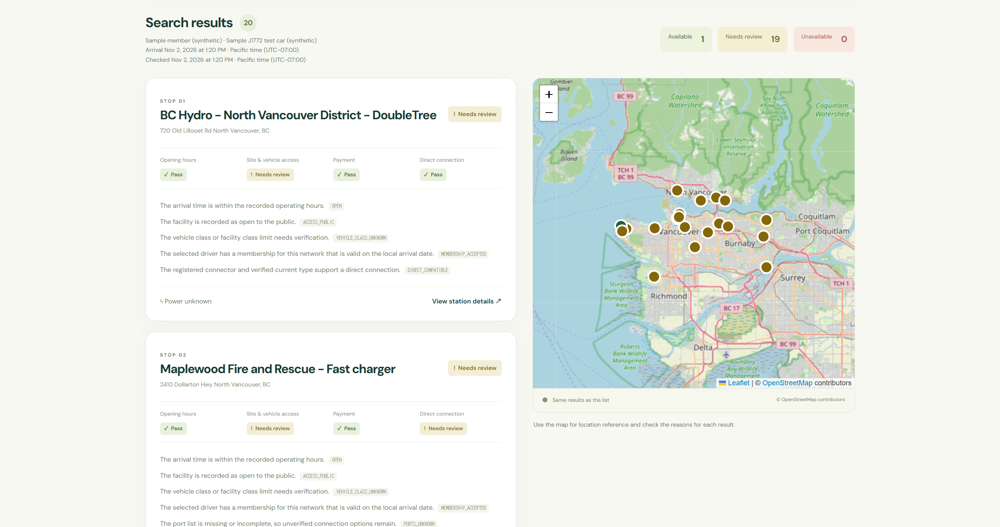
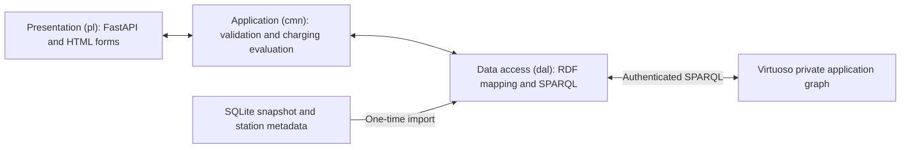

# PluggedIn

**A knowledge-graph-backed web application for vehicle-specific EV charging accessibility in British Columbia.**

PluggedIn helps drivers and fleet operators answer: **Can this driver and vehicle use this charging station at the selected arrival time?** It combines opening hours, site and vehicle access, direct connector compatibility, and payment conditions. Each check is `PASS`, `FAIL`, or `UNKNOWN`; the overall result is `AVAILABLE`, `UNAVAILABLE`, or `NEEDS_REVIEW`. Missing evidence remains unknown rather than being treated as permission to charge.

This README uses the bundled **20-station NLR–OCM Vancouver sample**. Virtuoso stores the runtime knowledge graph for station searches and driver, vehicle, and membership records. The app uses the bundled SQLite snapshot and station metadata as read-only migration inputs. The older five-station synthetic demo uses a different dataset.

## Example and supported features



The screenshot shows the station results and map for a sample search.

- Select a driver and vehicle independently in **Find charging**.
- Search using a date and time in **Pacific time (British Columbia)** or UTC. **Search now** uses the current instant.
- Read each station's four checks, reasons, source information, ports, and opening periods.
- Use **Fast Charging** to filter DC ports by minimum power and **Adapter Finder** to find catalogue matches for a registered vehicle.
- Add, edit, and delete records through **Drivers**, **Vehicles**, and **Memberships**.
- Use server-rendered forms, search, and details without JavaScript. Leaflet provides an optional map using OpenStreetMap tiles.

### A repeatable search

Use the original sample graph and these inputs.

1. Select **Sample member (synthetic)**, driver ID `1`.
2. Select the **J1772 test car (synthetic)**, vehicle ID `2`.
3. Enter **2026-11-02**, **12:00**, and **Pacific time (British Columbia)**.
4. Search with the initial map bounds and **All statuses**.

The search returns **20 stations** with **1 Available, 19 Needs review, and 0 Unavailable**. The Available station is **SWTCH Energy, 5965 Student Union Blvd, Vancouver**, internal station ID `11`. The same instant is `2026-11-02T19:00:00Z`. User edits to profiles, memberships, or station data may change these results.

For a visible operating-hours change, inspect station `5` (**GSPLP TGO 05**): its opening-hours check passes at **12:00** and fails at **23:00** on that Pacific date; at 23:00 its overall result is Unavailable. A daytime opening-hours pass alone does not guarantee an overall Available result. Synthetic sample memberships end on **2026-12-31**, so use the fixed date when reproducing this example.

## Requirements

- Python **3.12 or later**.
- Git to clone the repository; VS Code is optional.
- Python dependencies pinned in [requirements.txt](project/requirements.txt).
- OpenLink Virtuoso with a private application graph and a dedicated app credential.
- Internet access for package installation and optional map tiles/fonts.

## Installation and startup

**[Team setup guide for Windows and macOS](project/docs/TEAM_RDF_SETUP.en.md)**

In the repository, the guide is at `project/docs/TEAM_RDF_SETUP.en.md`.

Use the team branch that contains this README and the Virtuoso migration. Follow steps 1 through 5 to configure Virtuoso, load the TBox, migrate the sample data into the private application graph, and start PluggedIn. The guide also covers starting with an existing graph.

Open [PluggedIn](http://127.0.0.1:8000/), the [API documentation](http://127.0.0.1:8000/docs), or the [health endpoint](http://127.0.0.1:8000/api/v1/health). Press **Ctrl+C** in the app terminal to stop it.

### RDF files and data import

- **TBox (ontology)** defines classes such as `Station` and `Port` and relationships such as `hasPort`. Open the RDF/XML file in Protégé to inspect it. [PluggedIn.rdf](project/src/ca/uvic/ecs/csc501/dal/semantic/PluggedIn.rdf)
- **Base ABox (instance data)** contains the sample stations, ports, operating periods, and synthetic profiles. The [RDF/XML exporter](project/src/ca/uvic/ecs/csc501/dal/scripts/export_rdf.py) reads the bundled SQLite snapshot and metadata. Its output is a separate file for inspection or inclusion in the submission package.
- **Additional ABox triples** record published output evidence for Kaslo and Norgate Park and four catalogue adapters with connector direction, current type, and product sources. The first `sample20` migration applies the update automatically. To apply it to an already initialized `sample20` graph, follow the guide's `--sample-equipment` step. [SPARQL update](project/src/ca/uvic/ecs/csc501/dal/semantic/queries/sample20_equipment_evidence.ru) · [Update an existing graph](project/docs/TEAM_RDF_SETUP.en.md#update-an-existing-application-graph)

To generate the base ABox RDF/XML from `project/` on Windows after installing the package, run:

```powershell
New-Item -ItemType Directory -Force .\output | Out-Null
.\venv\Scripts\python.exe -m ca.uvic.ecs.csc501.dal.scripts.export_rdf --dataset sample20 --output output/sample20-data.rdf
```

On macOS, create `output/` with `mkdir -p output` and use `./venv/bin/python` with the same module and arguments. The exporter requires a new output path. `project/output/` is excluded from Git, so include the generated RDF/XML when packaging the ABox for assessment. The first-run migration initializes and checks the application state in an empty private graph. [First-run migration](project/docs/TEAM_RDF_SETUP.en.md#first-run-or-previous-rdf-only-upload)

### SPARQL queries and demo results

In the [competency queries file](project/src/ca/uvic/ecs/csc501/dal/semantic/queries/sparql_queries.rq), copy the two `PREFIX` declarations and one `SELECT` at a time. Replace its `GRAPH` IRI with the configured application graph (by default, `https://github.com/chohoon901/PluggedIn/graph/app/`). Execute it on the app instance's authenticated `/sparql-auth` endpoint. In Conductor's **Interactive SQL** on that instance, add `SPARQL` on the first line and end with `;`.

- **CQ1, stations by network.** The `BCHYDRO` query returns the BC Hydro DoubleTree station and its coordinates.
- **CQ2, minimum DC power.** Set `minimumPowerKw` to `50` or enter `50` in **Fast Charging**. Expect Kaslo at 250 kW and two Norgate Park connector rows at 50 kW. At 250 kW expect Kaslo, and at 251 kW expect zero results. The Kaslo value is an operator-published group maximum. The Norgate Park value is the installed DC charger rating.
- **CQ3, direct compatibility.** The Vancouver query returns eight matches between station ports and registered vehicles.
- **CQ4, adapter candidates.** In **Adapter Finder**, the `J1772COMBO test car (synthetic)` returns the Ford NACS-to-CCS1 adapter at DoubleTree and Kaslo. The other demo vehicles return four candidates for CHAdeMO, one for J1772, and 16 for Tesla. Candidate counts are per port and adapter combination.

To demonstrate graph writes, use **Drivers → Add driver** with a unique synthetic licence number, refresh to check the saved record, edit it, and delete the test entry. The app persists changes through SPARQL `DELETE` and `INSERT` clauses in its Virtuoso unit of work. [Full demo steps](project/docs/TEAM_RDF_SETUP.en.md#6-demo-steps-and-expected-results) · [Graph update implementation](project/src/ca/uvic/ecs/csc501/dal/semantic/store.py#L109-L126)

## Data, schema, and architecture

The migration maps the **13 tables and 65 columns** in the [SQLite DDL](project/src/ca/uvic/ecs/csc501/dal/scripts/schema.sql).

- Organizations and roles: `organization`, `site_owner`, `operator`, `network`.
- Charging facilities: `station`, `connector_type`, `port`, `operating_period`, `adapter`.
- Profiles and relationships: `vehicle`, `vehicle_accepts`, `driver`, `membership`.

Stations reference organizational roles; ports and opening periods reference stations. Vehicles accept connector types, while memberships connect drivers to networks over a date range. Driver licence numbers, VINs, station coordinates, and other candidate keys have uniqueness constraints. Station owner/operator/network references may be NULL. The RDF mapping preserves the schema's identifiers and relationship rules. Application writes enforce uniqueness, references and cascading deletes.



- `cmn/domain` and `cmn/enums`: domain entities, value objects, and canonical connector/vehicle classifications.
- `cmn/application`, `cmn/services`, and `cmn/contracts`: use cases, evaluation, repository interfaces, and result types.
- `dal`: Virtuoso queries, RDF mapping, transactions, configuration, and SQLite source import.
- `pl`: FastAPI routes, input schemas, server-rendered templates, and static assets.
- `main.py`: composition of the layers. Each write use case commits or rolls back its related changes through a unit of work.

### Active dataset and provenance

[DAL configuration](project/src/ca/uvic/ecs/csc501/dal/config.properties) selects the authenticated Virtuoso endpoint and app graph under `[semantic]`. The original sample files used by the one-time import are configured under `[sqlite]`.

```ini
[sqlite]
database_path=data/sample20/data/nlr_ocm_sample20.db
metadata_path=data/sample20/data/station_metadata.json
foreign_keys=true
busy_timeout_ms=5000
```

These paths are relative to `src/ca/uvic/ecs/csc501/dal/`. Keep the SQLite DB and metadata JSON together. The metadata carries time zones, source information, completeness, and uncertainty that are not extra schema columns. The adjacent `source_manifest.json` records source rows, hashes, and mapping decisions.

The sample contains **20 source charging facilities, 26 port records, 98 operating periods, 2 synthetic drivers, 4 synthetic LD vehicles, and 6 synthetic memberships**. NLR/AFDC CSV IDs match OCM `DataProvidersReference` values for the selected provider. OSM is not imported yet. Real source facilities are distinguished from fictional driver/vehicle/membership profiles. Source connector names are retained and interpreted through enum aliases; vehicle classes use **LD / MD / HD**. Estimated OCM power is not presented as verified equipment power.

Sources: [NLR transportation data](https://developer.nlr.gov/docs/transportation/), [AFDC field definitions](https://afdc.energy.gov/data_download/alt_fuel_stations_format), and [Open Charge Map](https://openchargemap.org/). Inclusion in this repository does not change the source providers' terms. The manifest identifies the actual supplied input files and their hashes.

## Rebuild the sample from source files

This path reconstructs the schema, sample records, and companion evidence from source files, without relying on the bundled DB. From `project/`, ensure these inputs exist:

- `datasets/alt_fuel_stations (Sep 21 2026).csv`
- `datasets/ocm_bc.json`

Run the importer into a **new, empty destination**:

```powershell
.\venv\Scripts\python.exe -m ca.uvic.ecs.csc501.dal.scripts.import_sample `
  --output-root src/ca/uvic/ecs/csc501/dal/data/readme-rebuild `
  --csv "datasets/alt_fuel_stations (Sep 21 2026).csv" `
  --ocm datasets/ocm_bc.json
```

The importer creates the DDL, populates records in a transaction, writes metadata and the manifest, and validates the result. It refuses an occupied destination; choose another new directory for another run. It leaves the active DB and source files unchanged.

To use the rebuilt sample in the web app, stop the server and change **both** paths in the application's DAL `config.properties` to:

```ini
database_path=data/readme-rebuild/data/nlr_ocm_sample20.db
metadata_path=data/readme-rebuild/data/station_metadata.json
```

Select a new private `app_graph_iri` and apply its access settings before running the migration. The current app graph retains existing registrations. [Virtuoso setup and migration](project/docs/TEAM_RDF_SETUP.en.md)

## Relational milestone reference

The earlier relational design remains available for comparing the SQLite schema and query patterns with the RDF implementation. Its SQL examples use the earlier synthetic dataset and legacy vehicle-class labels. [Relational report](docs/04_Relational/4_Relational_Sunghun_Jungwon_Elias.pdf) · [Relational SQL design](project/src/ca/uvic/ecs/csc501/dal/repositories/PluggedIn_Relational_Query_Design.sql)

## Validation and tests

`validate_db` checks the SQLite migration source's schema, integrity, foreign keys, and application aggregate rules. Use `migrate_to_virtuoso --check` to verify the Virtuoso graph used at runtime. To install development tools and run the project suites:

```powershell
.\venv\Scripts\python.exe -m pip install -r requirements-dev.txt
.\venv\Scripts\python.exe -m pytest tests/unit tests/integration tests/architecture
.\venv\Scripts\python.exe -m playwright install chromium
.\venv\Scripts\python.exe -m pytest tests/e2e --browser chromium
```

Past verification results are listed by version in [verification.md](project/docs/verification.md).

## Scope and limitations

Results describe recorded conditions, not real-time occupancy, faults, queues, road access, charging-bay clearance, actual payment authorization, or guaranteed charging power. Adapter Finder reports connector-based catalogue matches. Check vehicle-model and charging-network eligibility before using a candidate. Roaming is outside the current MVP. The access policy compares public eligibility and recorded LD/MD/HD limits; missing or restricted evidence remains Unknown. Unknown checks are displayed as **Needs review**. The map is optional; its tiles require internet access, and the list/details remain available without it.

## More documentation

- [Semantic Web report (LaTeX source)](docs/05_Semantic/5_Semantic_Sunghun_Jungwon_Elias_Updated.tex)
- [Sample construction and provenance](project/docs/sample20.md)
- [NLR vehicle classes and package structure](project/docs/nlr-vehicle-class.md)
- [Development plan](project/docs/PluggedIn_Development_Plan_AI_Agent.md)
- [Original approved architecture](project/docs/superpowers/specs/2026-10-26-pluggedin-design.md) and [sample20 design update](project/docs/superpowers/specs/2026-11-02-idnull-sample-design.md)
- [Current MVP access-policy record](project/docs/superpowers/plans/2026-11-02-mvp-class-only-access.md)

## Citation

When referring to this course project, cite Jungwon Youn, Sunghun Cho, and Elias Dockal, *PluggedIn: Representing Electric Vehicle Charging Accessibility* (2026), [project repository](https://github.com/chohoon901/PluggedIn). Include the branch/commit used for reproducibility. This is a project citation, not a claim of a published paper or DOI.

## License

The team-authored PluggedIn source code is licensed under the [MIT License](project/LICENSE). Copyright (c) 2026 Jungwon Youn, Sunghun Cho, and Elias Dockal.

Bundled Leaflet 1.9.4 retains its separate [BSD 2-Clause license](project/src/ca/uvic/ecs/csc501/pl/static/vendor/LEAFLET-LICENSE.txt); map attribution credits OpenStreetMap contributors. External datasets retain their providers' terms.
